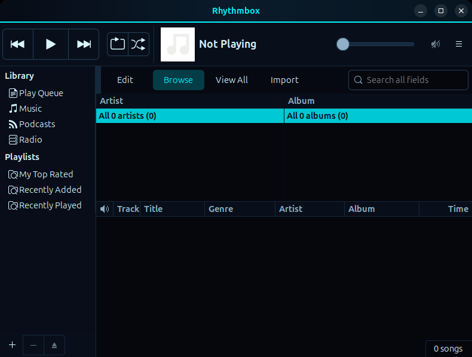

# Dexmond Arctic Cyan 1.1.0

This release fixes GTK 3 apps that stayed grey and adds themes for terminals, code editors, the GNOME Shell top bar, VS Code, Qt apps, Chrome and Firefox. Every part is optional and is backed up before install.



## Fixed
- **GTK 3 apps were half grey.** In 1.0.0, Rhythmbox, gedit, file choosers and other GTK 3 apps kept Yaru's grey lists, sidebars, panes and buttons; only their header bars changed. Yaru's GTK 3 stylesheet uses fixed colours, not named ones, so the 1.0.0 overrides did not reach them. 1.1.0 sets every GTK 3 colour name and adds explicit rules, covering every widget state, for:
  - lists, tree views, icon views, column headers, sidebars, panes and tabs;
  - toolbars, buttons, entries, spin buttons and combo boxes;
  - scales, progress and level bars, switches, check boxes and radio buttons;
  - menus, popovers, tooltips, info bars, status bars, scrollbars and selections, including windows in the background.

  Rhythmbox's browser and track lists are now navy, with cyan selection.
- **Terminal palette:** the bright-blue and bright-white slots were yellow and bright magenta was rose. Bold text was yellow; it now uses the normal text colour.
- **Contrast:** the header-bar title of a window in the background is now `#7fa6bd` (7.3:1, was `#557d96`).

## New
| Part | Covers | Default |
|---|---|---|
| libadwaita colours | Window, view, header bar, sidebar, secondary sidebar, card, dialog, popover, thumbnail, shade and border colours. Also the accent, destructive, success, warning and error colours. | on |
| Ptyxis | Palette file and a **Dexmond** profile | on, if installed |
| Text editors | **Dexmond Arctic Cyan** GtkSourceView scheme, selected in GNOME Text Editor and gedit | on |
| GNOME Shell | Top bar, menus, quick settings, calendar, notifications, dash, search, switcher and dialogs | only if the User Themes extension is already enabled |
| VS Code / VSCodium | Colour theme: UI, syntax and terminal colours | on, if installed (select it in VS Code) |
| Qt | qt5ct / qt6ct colour scheme | on, if installed (select it in qt5ct / qt6ct) |
| Chrome / Chromium | Unpacked theme folder | on, if installed (load it once by hand) |
| Firefox | `userChrome.css` for the toolbar, tabs and menus | off (`--firefox`) |
| Flatpak | Lets Flatpak apps read the GTK colour files (read-only) | off (`--flatpak`) |

Errors and destructive buttons are pink, warnings yellow and success mint. The theme has no red or orange accents.

Every text colour pair passes WCAG AA. The lowest body-text pair is 7.15:1. The measured ratios are in `TESTING.md`, and `tools/contrast.py` recomputes them.

## Install
```bash
tar xzf dexmond-arctic-cyan-1.1.0.tar.gz
cd dexmond-arctic-cyan-1.1.0
./install.sh                        # everything that applies to this computer
./install.sh --wallpaper neural     # circuit (default) | neural | horizon
./install.sh --firefox --flatpak    # the two parts that are off by default
./install.sh --help                 # all options
```
Restart open apps, or log out and back in, to see the change everywhere. The README covers the steps you do by hand: picking the theme in VS Code, qt5ct and Chrome, and setting up the User Themes extension for the top bar.

**Upgrading from 1.0.0:** run the 1.0.0 `./uninstall.sh`, or the 1.1.0 one (it reads 1.0.0 backups), and then the 1.1.0 `./install.sh`.

## Uninstall
```bash
./uninstall.sh
```
This puts back everything that was saved in `~/.local/share/dexmond-theme/backup-<date>/`:
- your `gtk.css` files;
- every setting the installer changed (a setting that was at its default is reset);
- every file it replaced or edited, including Firefox's `user.js` and the Flatpak override file.

It also removes what the theme added and the folders the installer created.

## Known limits
- **Snap apps** (Firefox, Thunderbird, Brave and App Center on Ubuntu) do not read `~/.config/gtk-3.0` or `gtk-4.0`, so their window contents keep their own colours.
- **Flatpak apps** need `--flatpak`. Electron apps such as Obsidian ignore GTK colours.
- **Qt apps** need qt5ct/qt6ct and `QT_QPA_PLATFORMTHEME`. Kvantum is not supported.
- **GNOME Shell** needs the User Themes extension. The installer never installs or enables extensions.
- **Already-open apps** keep their old colours until they are restarted.
- **Not yet tested in a running app:** the GNOME Shell theme, Ptyxis, VS Code, Qt, Chrome, Firefox, Flatpak, and the libadwaita colours on screen. See `TESTING.md`.

## Assets
- `dexmond-arctic-cyan-1.1.0.tar.gz`
- `dexmond-arctic-cyan-1.1.0.tar.gz.sha256`
